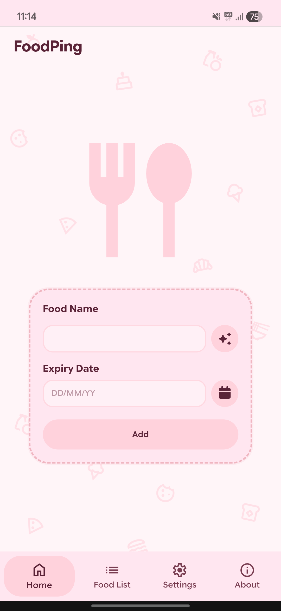
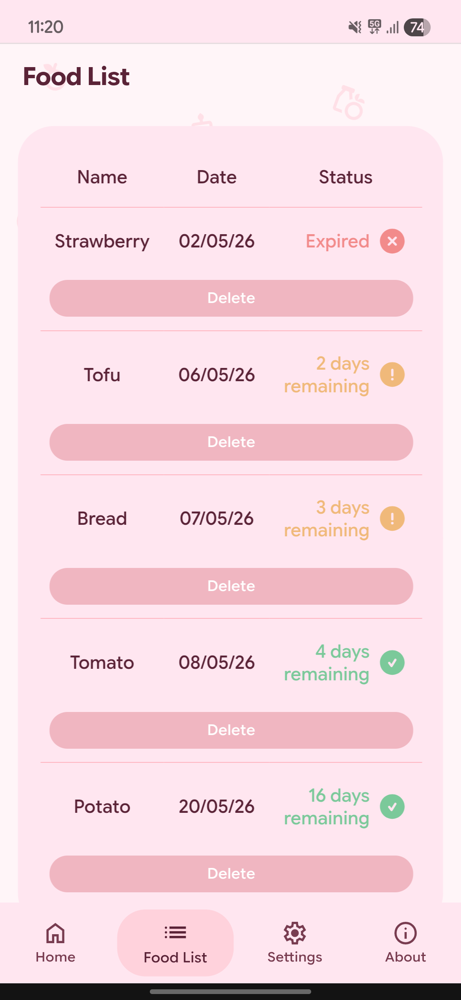
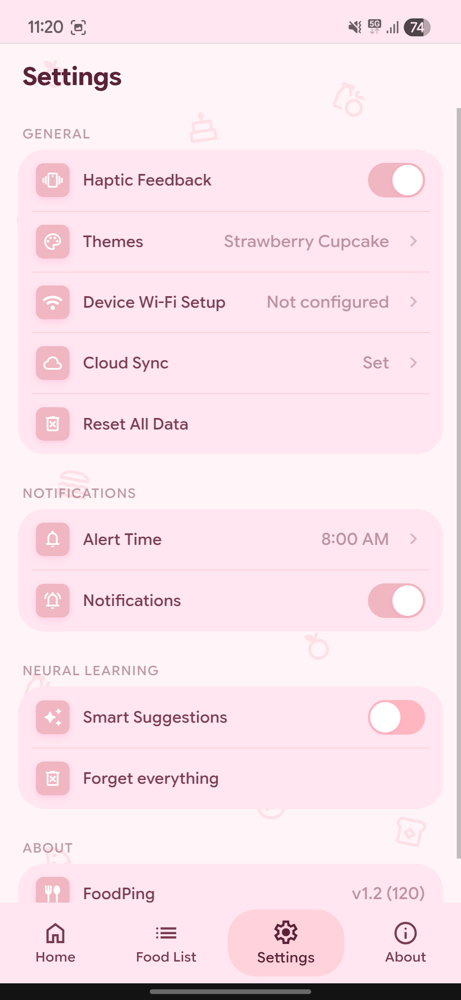
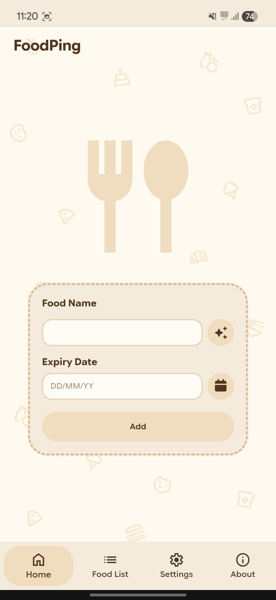
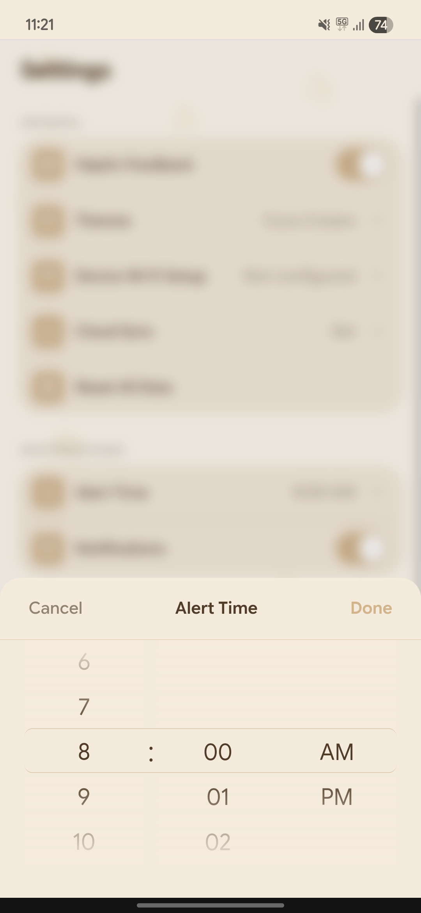
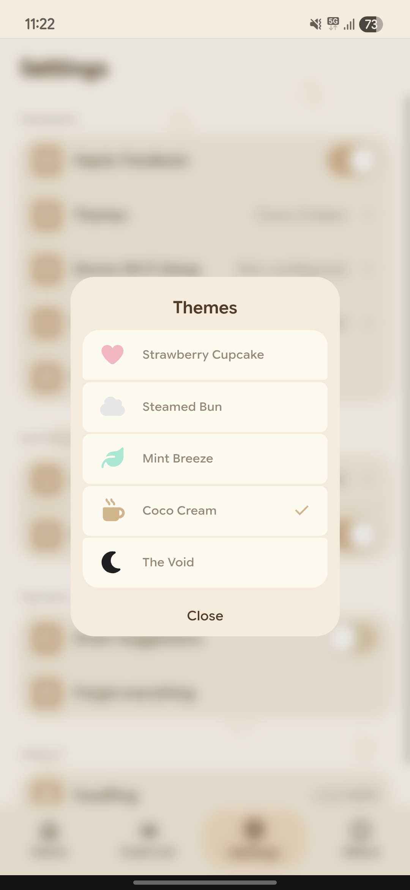

<div align="center">

<h1>FoodPing</h1>
<p>Simple food expiry tracker with smart reminders</p>
<p>This repo are its software part, now built with <a href="https://astro.build">Astro 7</a>.</p>
<p align="center">
  <a href="https://github.com/rynekryz/foodping/stargazers"></a>
  
  
  
</p>

<h1>Screenshots</h1>








</div>

<div align="center">
<h1>Features</h1>
</div>

- Add and track food expiry dates easily
- Smart expiry status (safe / warning / expired)
- Daily reminder notification at custom time
- Custom time picker UI
- Haptic feedback support (vibration)
- Notification and haptic toggles in settings
- Local storage based (no account required)
- Delete individual food entries
- Auto remove expired items
- Clean logs view with status indicators
- Empty state when no data
- Smart food suggestion system (learns frequent inputs)
- Random food picker
- Custom alert modal system
- Smooth page navigation animations
- Multiple themes (strawberry, mint, coco, void, etc.)
- Theme switcher with transition effects
- Greeting system based on time and username
- WiFi setup for ESP integration
- Cloud ID linking for external sync
- Progressive Web App (installable on mobile)
- Offline support
- Backup and restore
- Md3 expressive inspired
- etc.

## Development

Requires Node.js 22.23.4 or newer.

```sh
npm install
npm run dev      # http://localhost:4321/foodping/
npm run build    # static site in ./dist
npm run preview  # serve ./dist locally
```

## Deploy to GitHub Pages

1. Push this project to your GitHub repo (branch `main`).
2. In the repo go to **Settings → Pages → Build and deployment → Source** and choose **GitHub Actions**.
3. Every push to `main` now builds and publishes the site (`.github/workflows/deploy.yml`).

The base path is picked up from the repo name automatically (`https://<user>.github.io/<repo>/`).
To build locally for a different location:

```sh
SITE=https://example.com BASE_PATH=/ npm run build
```

## Device (ESP32)

`Device/foodping.cpp` is the firmware that mirrors the app on an ESP32 (Arduino framework).

| Feature | App | Device |
| --- | --- | --- |
| Expiry status (safe / warning / expired) | Logs page | Green / yellow / red LED (pins 25 / 26 / 27) |
| Daily reminder at 8:00 AM | Notification | Buzzer on pin 14, button on pin 0 silences it |
| WiFi setup | Settings → WiFi | Hotspot `FoodPing-Setup`, `POST /save` |
| Reset WiFi | Settings → WiFi → Reset | `POST esp32.local/reset-wifi`, or hold the button 5 s |
| Cloud sync | Cloud ID | Reads foods from your Apps Script `/exec` every minute |

Setup:

1. Install the ESP32 Arduino core 3.x and ArduinoJson 7.
2. PlatformIO: copy the file to `src/main.cpp`. Arduino IDE: copy it into a sketch folder and rename it `foodping.ino`.
3. Edit the constants at the top: `ALLOWED_ORIGIN` (your Pages URL), `TIMEZONE`, `ALERT_HOUR`, `ALERT_MINUTE`, pins.
4. Flash, connect to `FoodPing-Setup`, then save WiFi and Cloud ID from the app.

The Apps Script `GET` response must be JSON: either `[{ "name": "Milk", "date": 1767225600000 }]` or `{ "foods": [...] }` (`date` is the expiry in milliseconds, the same value the app sends).

## Project layout

```
public/            icon, badge, manifest (copied as-is)
src/pages/         index.astro, 404.astro, sw.js.ts (service worker, generated with the right base path)
src/layouts/       Layout.astro (<head>, fonts, meta)
src/components/    one component per page / modal
src/styles/        ui.css (original styles) + generated Font Awesome subset
src/scripts/       app logic split into small ES modules (feed.js loads only when needed)
Device/            ESP32 firmware (foodping.cpp)
scripts/           fa-subset.mjs - trims Font Awesome to the icons actually used
```

<div align="center">
<strong>Made with ♥︎ by Ryne</strong><br/>
<sub>Forked from FoodPing by Izatifoodie</sub>
</div>

<br>

<div align="center">
  <a href="https://discord.gg/YKhWXXhKmC"></a>
  <a href="https://tiktok.com/@rynekryz"></a>
</div>
