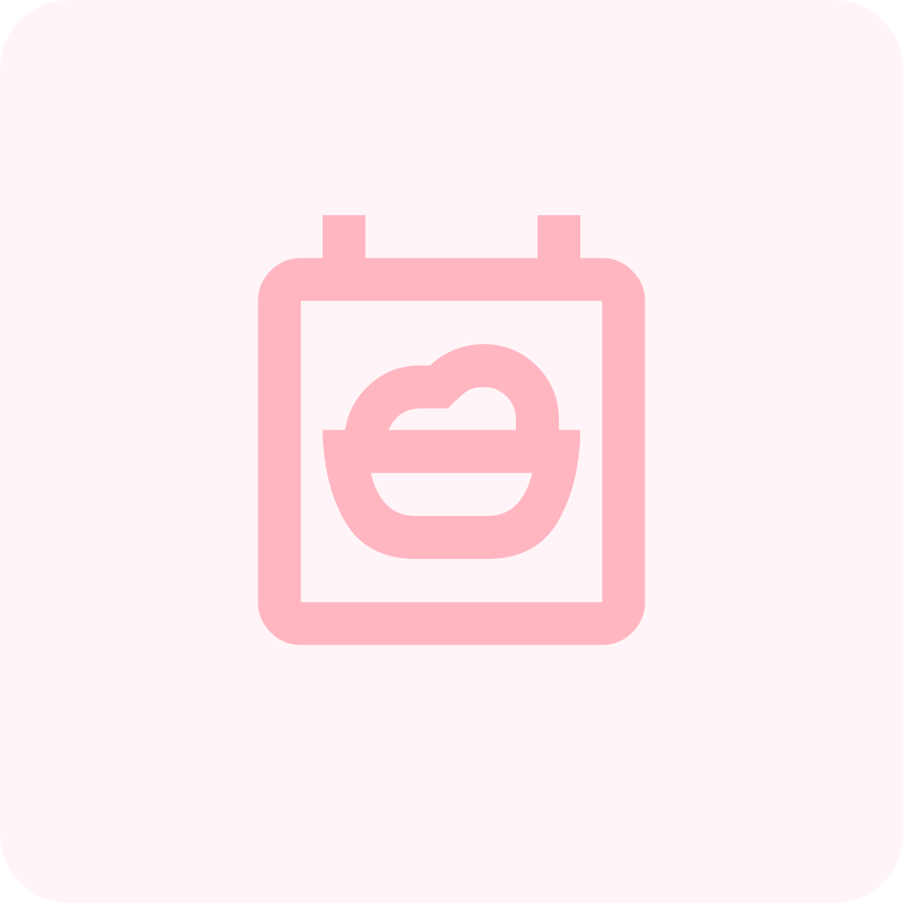
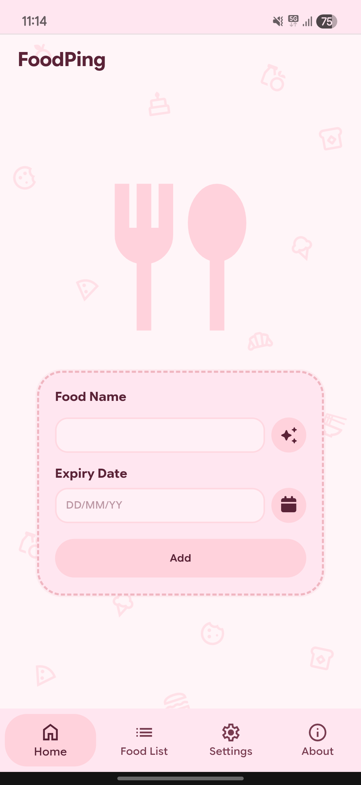
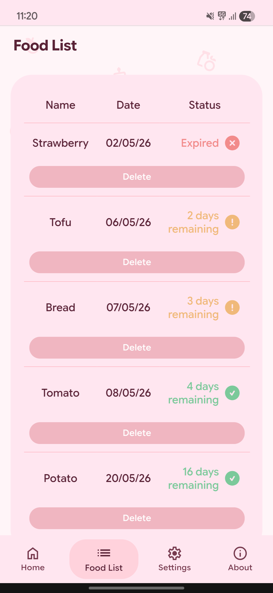
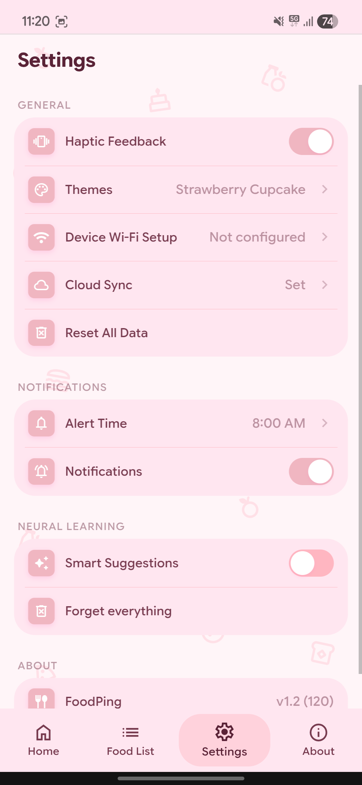
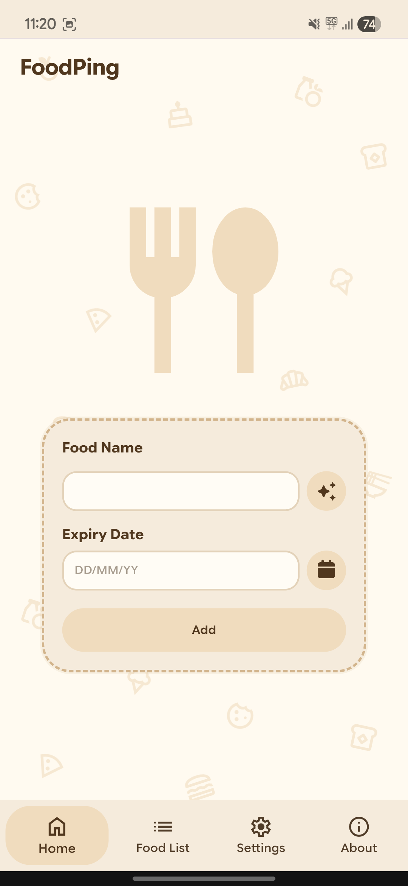
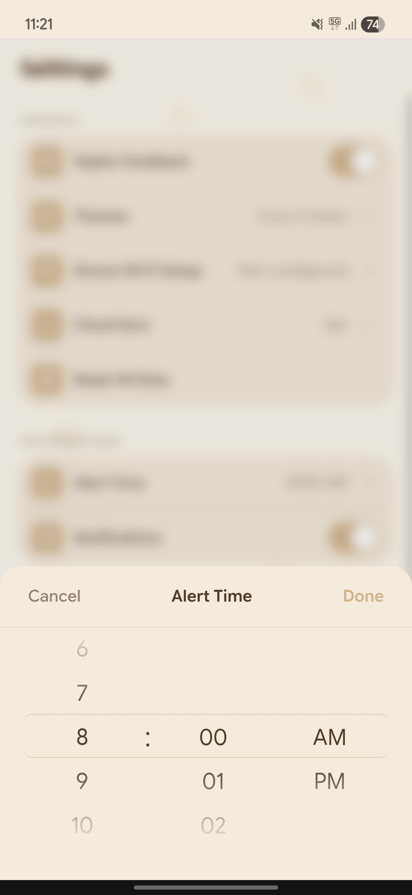
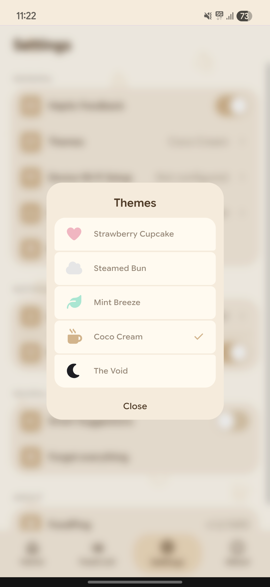

<div align="center">

<!-- decor:top -->
<picture><source media="(prefers-color-scheme: dark)" srcset="https://raw.githubusercontent.com/rynekryz/rynekryz/main/pixel-art/pink/sky-banner-dark.svg"></picture>

<picture><source media="(prefers-color-scheme: dark)" srcset="https://raw.githubusercontent.com/rynekryz/rynekryz/main/pixel-art/pink/divider-dots-dark.svg"></picture>
<!-- /decor:top -->


<h1>FoodPing</h1>
<p>A simple food expiry tracker for your phone and an ESP32.</p>
<p>Track expiry dates, get daily reminders, and keep everything local. Built with Astro 7, with the firmware included.</p>
</div>
<p align="center">
  <a href="https://github.com/rynekryz/foodping/stargazers"></a>
  
  
  
</p>

<p align="center">
  <a href="https://github.com/rynekryz/foodping"></a>
</p>

<div align="center">
<picture><source media="(prefers-color-scheme: dark)" srcset="https://raw.githubusercontent.com/rynekryz/rynekryz/main/pixel-art/pink/divider-dots-dark.svg"></picture>
</div>

## Screenshots

<div align="center">






</div>

<div align="center">
<picture><source media="(prefers-color-scheme: dark)" srcset="https://raw.githubusercontent.com/rynekryz/rynekryz/main/pixel-art/pink/divider-dots-dark.svg"></picture>
</div>

## Features

- Add and track expiry dates without thinking too hard
- Safe / warning / expired status at a glance, so nothing surprises you from the back of the fridge
- Daily reminder at a time you pick
- Haptic feedback, with notification and haptic toggles
- Everything stays local, no account needed
- Delete entries, or let expired ones clean themselves up
- A tidy logs view with status dots
- Smart suggestions that learn what you eat a lot
- Random food picker for the indecisive days
- Multiple themes (strawberry, mint, coco, void, etc.) with a soft switcher
- Greeting that changes with the time and your name
- WiFi setup and Cloud ID for the ESP32
- Installable PWA with offline support
- Backup and restore
- Material 3 Expressive inspired
- etc.

<div align="center">
<picture><source media="(prefers-color-scheme: dark)" srcset="https://raw.githubusercontent.com/rynekryz/rynekryz/main/pixel-art/pink/divider-dots-dark.svg"></picture>
</div>

## Technical Stack

- **Frontend:** Astro 7 with vanilla JavaScript
- **Styling:** CSS with a trimmed Font Awesome subset
- **Offline:** service worker and a PWA manifest
- **Device:** ESP32 firmware (Arduino C++)
- **Language:** JavaScript and C++
- **Build:** npm

<div align="center">
<picture><source media="(prefers-color-scheme: dark)" srcset="https://raw.githubusercontent.com/rynekryz/rynekryz/main/pixel-art/pink/divider-dots-dark.svg"></picture>
</div>

## Development

You'll need Node.js 22.23.4 or newer.

```sh
npm install
npm run dev      # http://localhost:4321/foodping/
npm run build    # static site in ./dist
npm run preview  # serve ./dist locally
```

## Deploying

Push to `main`, then set **Settings → Pages → Source** to **GitHub Actions**. Every push builds and publishes through `.github/workflows/deploy.yml`, and the base path comes from the repo name.

## ESP32

`Device/foodping.cpp` mirrors the app on an ESP32 (Arduino framework).

| Feature | App | Device |
| --- | --- | --- |
| Expiry status | Logs page | Green / yellow / red LED (pins 25 / 26 / 27) |
| Daily reminder at 8:00 | Notification | Buzzer on pin 14, button on pin 0 silences it |
| WiFi setup | Settings → WiFi | Hotspot `FoodPing-Setup`, `POST /save` |
| Reset WiFi | Settings → WiFi → Reset | `POST esp32.local/reset-wifi`, or hold the button 5 s |
| Cloud sync | Cloud ID | Reads foods from Apps Script `/exec` every minute |

Setup: install ESP32 Arduino core 3.x and ArduinoJson 7, then copy the file in as `src/main.cpp` (PlatformIO) or `foodping.ino` (Arduino IDE). Edit the constants at the top, flash it, and connect to `FoodPing-Setup` to save WiFi and Cloud ID from the app.

The Apps Script `GET` should return JSON: `[{ "name": "Milk", "date": 1767225600000 }]` or `{ "foods": [...] }`.

<div align="center">
<picture><source media="(prefers-color-scheme: dark)" srcset="https://raw.githubusercontent.com/rynekryz/rynekryz/main/pixel-art/pink/divider-dots-dark.svg"></picture>
</div>

## Project Structure

```
FoodPing/
├── src/
│   ├── components/
│   ├── layouts/
│   ├── pages/
│   ├── scripts/
│   └── styles/
├── public/
├── docs/screenshots/
├── Device/
└── scripts/
```

<div align="center">
<picture><source media="(prefers-color-scheme: dark)" srcset="https://raw.githubusercontent.com/rynekryz/rynekryz/main/pixel-art/pink/divider-dots-dark.svg"></picture>
</div>

<!-- decor:bottom -->
<div align="center">

<picture><source media="(prefers-color-scheme: dark)" srcset="https://raw.githubusercontent.com/rynekryz/rynekryz/main/pixel-art/pink/divider-wave-dark.svg"></picture>

<picture><source media="(prefers-color-scheme: dark)" srcset="https://raw.githubusercontent.com/rynekryz/rynekryz/main/pixel-art/pink/sticker-heart-dark.svg"></picture> <picture><source media="(prefers-color-scheme: dark)" srcset="https://raw.githubusercontent.com/rynekryz/rynekryz/main/pixel-art/pink/sticker-sparkle-dark.svg"></picture> <picture><source media="(prefers-color-scheme: dark)" srcset="https://raw.githubusercontent.com/rynekryz/rynekryz/main/pixel-art/pink/sticker-moon-dark.svg"></picture> <picture><source media="(prefers-color-scheme: dark)" srcset="https://raw.githubusercontent.com/rynekryz/rynekryz/main/pixel-art/pink/sticker-flower-dark.svg"></picture> <picture><source media="(prefers-color-scheme: dark)" srcset="https://raw.githubusercontent.com/rynekryz/rynekryz/main/pixel-art/pink/sticker-cat-dark.svg"></picture> <picture><source media="(prefers-color-scheme: dark)" srcset="https://raw.githubusercontent.com/rynekryz/rynekryz/main/pixel-art/pink/sticker-ghost-dark.svg"></picture> <picture><source media="(prefers-color-scheme: dark)" srcset="https://raw.githubusercontent.com/rynekryz/rynekryz/main/pixel-art/pink/sticker-lock-dark.svg"></picture>

</div>
<!-- /decor:bottom -->

<div align="center">
<strong>Made with ♥︎ by Ryne</strong><br/>
<sub>Forked from FoodPing by Izatifoodie</sub>
</div>
<div align="center">
  <a href="https://discord.gg/YKhWXXhKmC"></a>
  <a href="https://tiktok.com/@rynekryz"></a>
</div>
